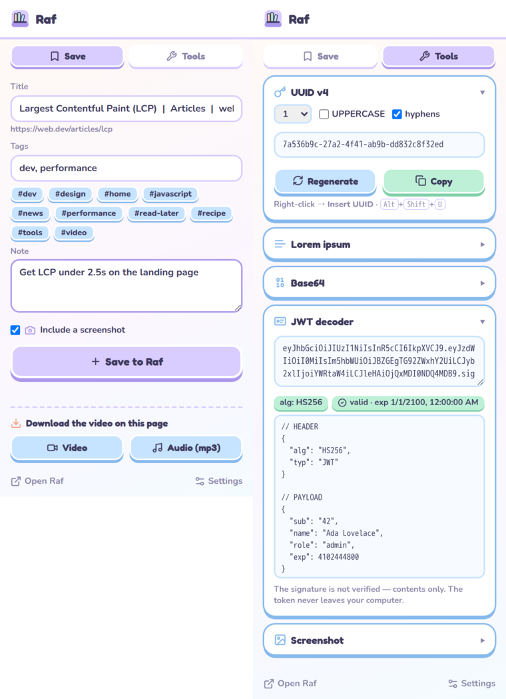
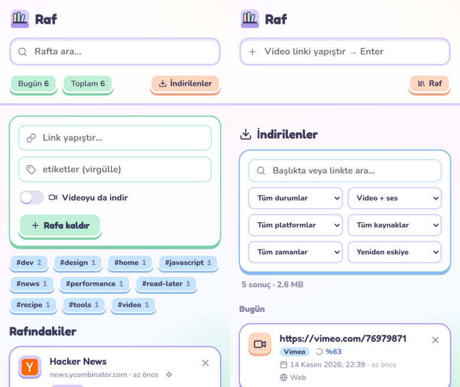
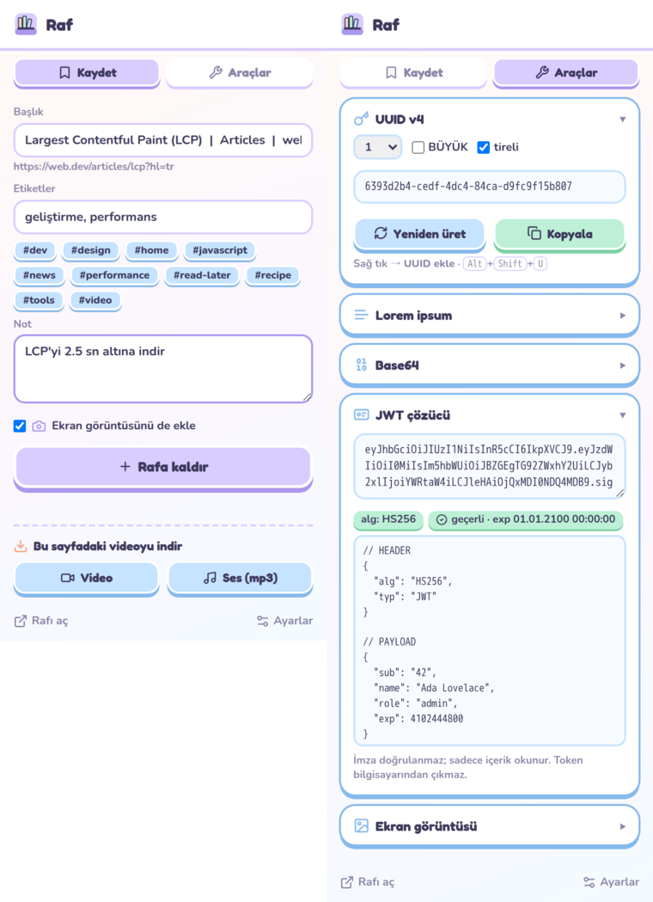

<p align="center">
  
</p>

<h1 align="center">Raf</h1>

<p align="center">
  <b>Your own self-hosted "read later" shelf — with a Chrome extension, video downloads and a Telegram bot.</b><br>
  <a href="#english">English</a> · <a href="#türkçe">Türkçe</a>
</p>

<p align="center">
  
</p>

---

## English

Raf (*"shelf"* in Turkish) saves the page you're looking at to **your own server** in one click — title, tags, a note, the page's readable text and a screenshot — so you can find it again later, even if the original site goes away. It also downloads videos from almost anywhere and bundles a few small tools developers use every day.

### Features

**Chrome extension**
- Save the current page, a link or a text selection (popup, right-click menu or <kbd>Alt</kbd>+<kbd>Shift</kbd>+<kbd>S</kbd>)
- Tags with suggestions, notes, optional screenshot of the visible area
- **Video & audio download** from YouTube, X/Twitter, Instagram, TikTok, Reddit, Vimeo and [1000+ sites](https://github.com/yt-dlp/yt-dlp/blob/master/supportedsites.md) — the file lands in your *Downloads/Raf* folder automatically. Sites that need a login (Instagram…) work with your browser session; cookies are sent for that one job only and never stored.
- **Tools:** UUID v4 generator (also right-click → *Insert UUID* or <kbd>Alt</kbd>+<kbd>Shift</kbd>+<kbd>U</kbd> into any field), Lorem ipsum, Base64 (UTF-8 safe), JWT decoder, screenshot to PNG / clipboard
- English and Turkish UI — follows your browser language, or pick one in Settings
- Tells you when a newer version is available on your server

**Server & web app**
- FastAPI + SQLite with full-text search that ignores Turkish diacritics (*bakim* finds *bakım*)
- Web UI and installable **PWA** (add to the iPhone home screen), in English and Turkish (TR/EN switch)
- Download queue powered by yt-dlp + ffmpeg; videos are converted to H.264 when needed so they play and save on iPhone
- Downloads page with search, filters (status, type, platform, source, date) and sorting

**Telegram bot**
- Send a link → saved. Add `#tags` and a note in the same message
- `/indir <link>` video, `/ses <link>` audio only (files under 50 MB arrive in the chat)
- `/bugun`, `/son`, `/ara <word>` and a daily digest at 21:00

<p align="center">
  <br>
  
</p>

### Run it

```yaml
# docker-compose.yml
services:
  raf:
    build: ./server
    env_file: [raf.env]            # RAF_API_TOKEN=…, optional RAF_TELEGRAM_TOKEN / RAF_TELEGRAM_CHAT_ID
    environment:
      RAF_PUBLIC_URL: https://your-server:8454
      RAF_DIGEST_HOUR: "21"
    volumes:
      - ./data:/data               # database + screenshots
      - ./extension:/ext:ro        # served as /extension.zip, pre-configured with URL + token
      - ./videos:/videos           # downloaded videos
    ports: ["127.0.0.1:8098:8000"]
```

Put it behind HTTPS (e.g. Tailscale Serve, Caddy). Raf is designed for a private network — the web UI has no login of its own; the API is protected by `RAF_API_TOKEN`.

**Install the extension:** open `https://your-server/extension.zip` → unzip → `chrome://extensions` → *Developer mode* → *Load unpacked*. The server URL and token are already filled in.
**Update:** unzip the new zip over the same folder and press ↻ on the Raf card.

### Project layout

```
server/      FastAPI app (app/main.py, db.py, downloads.py, telegram.py) + Dockerfile
extension/   Chrome MV3 extension (_locales/en, _locales/tr)
docs/        screenshots
```

---

## Türkçe

Raf, baktığın sayfayı tek tıkla **kendi sunucuna** kaydeder: başlık, etiketler, not, sayfanın okunabilir metni ve ekran görüntüsü. Böylece site kapansa bile içeriği bulursun. Ayrıca neredeyse her yerden video indirir ve günlük işlerde lazım olan küçük geliştirici araçlarını bir arada sunar.

### Özellikler

**Chrome eklentisi**
- Sayfayı, bir linki ya da seçili metni kaydet (popup, sağ tık menüsü veya <kbd>Alt</kbd>+<kbd>Shift</kbd>+<kbd>S</kbd>)
- Önerili etiketler, not, isteğe bağlı ekran görüntüsü
- **Video ve ses indirme:** YouTube, X/Twitter, Instagram, TikTok, Reddit, Vimeo ve [1000'den fazla site](https://github.com/yt-dlp/yt-dlp/blob/master/supportedsites.md). Dosya otomatik olarak *İndirilenler/Raf* klasörüne iner. Giriş isteyen siteler (Instagram…) tarayıcı oturumunla çalışır; çerezler sadece o indirme için gönderilir, saklanmaz.
- **Araçlar:** UUID v4 (sağ tık → *UUID ekle* veya <kbd>Alt</kbd>+<kbd>Shift</kbd>+<kbd>U</kbd> ile herhangi bir alana yazar), Lorem ipsum, Base64 (UTF-8 uyumlu), JWT çözücü, ekran görüntüsünü PNG/panoya alma
- Türkçe ve İngilizce arayüz — tarayıcının diline göre açılır ya da Ayarlar'dan seçilir
- Sunucuda yeni sürüm varsa haber verir

<p align="center"></p>

**Sunucu ve web uygulaması**
- FastAPI + SQLite; Türkçe karakter duyarsız tam metin arama (*bakim* yazınca *bakım* bulunur)
- Web arayüzü ve telefona kurulabilen **PWA** (iPhone ana ekranına eklenebilir), Türkçe ve İngilizce (TR/EN düğmesi)
- yt-dlp + ffmpeg ile indirme kuyruğu; videolar gerekirse H.264'e çevrilir, iPhone'da oynar ve Fotoğraflar'a kaydedilir
- İndirilenler sayfasında arama, filtreler (durum, tür, platform, kaynak, tarih) ve sıralama

<p align="center"></p>

**Telegram botu**
- Link gönder → kaydedilir. Aynı mesaja `#etiket` ve not ekleyebilirsin
- `/indir <link>` video, `/ses <link>` sadece ses (50 MB altı dosyalar sohbete gelir)
- `/bugun`, `/son`, `/ara <kelime>` ve her akşam 21:00'de günlük özet

### Kurulum

Yukarıdaki *Run it* bölümündeki `docker-compose.yml` örneğini kullan. Raf özel bir ağ (ör. Tailscale) için tasarlandı: web arayüzünün kendi girişi yok, API `RAF_API_TOKEN` ile korunuyor.

**Eklenti:** `https://sunucun/extension.zip` → klasöre çıkar → `chrome://extensions` → *Geliştirici modu* → *Paketlenmemiş öğe yükle*. Sunucu adresi ve anahtar hazır gelir.
**Güncelleme:** Yeni zip'i aynı klasörün üzerine çıkar, Raf kartında ↻'ye bas.

---

<p align="center"><sub>Icons: <a href="https://lucide.dev">Lucide</a> (ISC) · Video engine: <a href="https://github.com/yt-dlp/yt-dlp">yt-dlp</a></sub></p>
