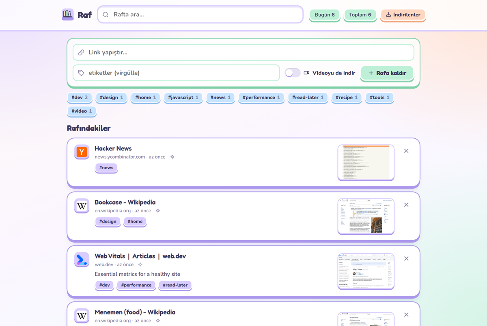
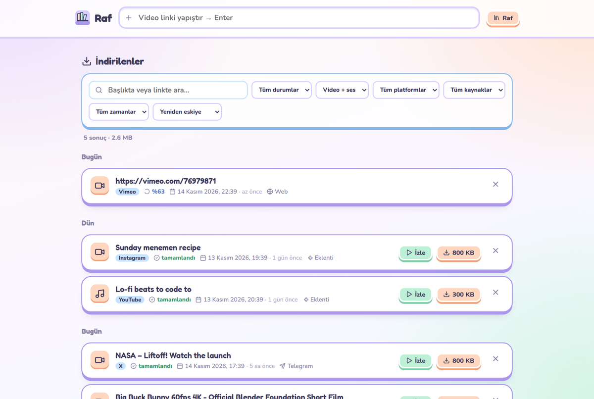

<p align="center">
  
</p>

<h1 align="center">Raf</h1>

<p align="center">
  <b>Your own self-hosted "read later" shelf — with a Chrome extension, video downloads and a Telegram bot.</b>
</p>

<p align="center">
  <b>English</b> · <a href="README.tr.md">Türkçe</a>
</p>

<p align="center">
  
</p>

Raf (*"shelf"* in Turkish) saves the page you're looking at to **your own server** in one click: title, tags, a note, the page's readable text and a screenshot. You can find it again later, even if the original site goes away. It also downloads videos from almost anywhere and bundles the small tools developers and testers reach for every day.

## Screenshots

<table>
  <tr>
    <td align="center" width="50%"><br><sub>Chrome extension: save and tools</sub></td>
    <td align="center" width="50%"><br><sub>Web app: your shelf with full-text search</sub></td>
  </tr>
  <tr>
    <td align="center"><br><sub>Downloads: search, filters, play in the browser</sub></td>
    <td align="center"><br><sub>Installable PWA on the phone</sub></td>
  </tr>
</table>

## Features

### Chrome extension
- **Save** the current page, a link or a text selection (popup, right-click menu or <kbd>Alt</kbd>+<kbd>Shift</kbd>+<kbd>S</kbd>). Includes tag suggestions, a note and an optional screenshot of the visible area.
- **Sessions:** save all open tabs at once and reopen them later in a new window.
- **Video & audio download** from YouTube, X/Twitter, Instagram, TikTok, Reddit, Vimeo and [1000+ sites](https://github.com/yt-dlp/yt-dlp/blob/master/supportedsites.md):
  - a **Raf button on top of videos** with quality selection (up to 4K)
  - files land in *Downloads/Raf* automatically
  - sites that need a login (Instagram…) work with your browser session; cookies are sent for that one job only and never stored
- **Send to phone:** QR code of the current page, or send it to your Telegram.
- **For developers & testers:**
  - **Locator picker:** click an element and get a Playwright locator (`getByRole`, `getByTestId`…), <kbd>Alt</kbd>+<kbd>Shift</kbd>+<kbd>L</kbd>
  - **Test data (TR):** names, emails, phone numbers, addresses, valid national ID / tax numbers / IBANs
  - **Fill form:** fill a whole form with one fake person, <kbd>Alt</kbd>+<kbd>Shift</kbd>+<kbd>F</kbd>. Fields you've already typed in are never overwritten.
  - UUID v4 (right-click → *Insert UUID* or <kbd>Alt</kbd>+<kbd>Shift</kbd>+<kbd>U</kbd>), Lorem ipsum, Base64 (UTF-8 safe), JWT decoder, screenshot to PNG / clipboard
- **Settings:** turn every feature, menu entry and tool on or off. UI in English or Turkish.
- Tells you when a newer version is available on your server.

### Server & web app
- FastAPI + SQLite with full-text search that ignores Turkish diacritics (*bakim* finds *bakım*)
- Web UI and installable **PWA** (add to the iPhone home screen), in English and Turkish
- Download queue powered by yt-dlp + ffmpeg; videos are converted to H.264 when needed so they play and save on iPhone
- Downloads page with search, filters (status, type, platform, source, date) and sorting

### Telegram bot
- Send a link and it's saved. Add `#tags` and a note in the same message.
- `/indir <link>` downloads video, `/ses <link>` downloads audio only (files under 50 MB arrive in the chat)
- `/bugun`, `/son`, `/ara <word>` and a daily digest at 21:00

## Run it

```yaml
# docker-compose.yml
services:
  raf:
    build: ./server
    env_file: [raf.env]            # RAF_API_TOKEN=…, optional RAF_TELEGRAM_TOKEN / RAF_TELEGRAM_CHAT_ID
    environment:
      RAF_PUBLIC_URL: https://your-server:8454
      RAF_DIGEST_HOUR: "21"
    volumes:
      - ./data:/data               # database + screenshots
      - ./extension:/ext:ro        # served as /extension.zip, pre-configured with URL + token
      - ./videos:/videos           # downloaded videos
    ports: ["127.0.0.1:8098:8000"]
```

Put it behind HTTPS (e.g. Tailscale Serve, Caddy). Raf is designed for a private network: the web UI has no login of its own, and the API is protected by `RAF_API_TOKEN`.

**Install the extension:**
1. Open `https://your-server/extension.zip` and unzip it.
2. Go to `chrome://extensions` and turn on *Developer mode*.
3. Click *Load unpacked* and pick the unzipped folder.

The server URL and token are already filled in.

**Update:** unzip the new zip over the same folder and press ↻ on the Raf card.

## Project layout

```
server/      FastAPI app (app/main.py, db.py, downloads.py, telegram.py, web.py) + Dockerfile
extension/   Chrome MV3 extension (_locales/en, _locales/tr)
docs/        screenshots and demo
```

## License

[MIT](LICENSE) © Selim Yalınkılıç

<p align="center"><sub>Icons: <a href="https://lucide.dev">Lucide</a> (ISC) · QR codes: <a href="https://github.com/kazuhikoarase/qrcode-generator">qrcode-generator</a> (MIT) · Video engine: <a href="https://github.com/yt-dlp/yt-dlp">yt-dlp</a></sub></p>
