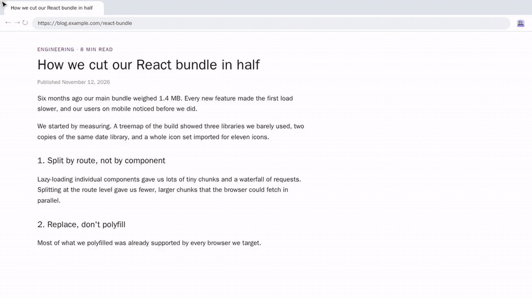
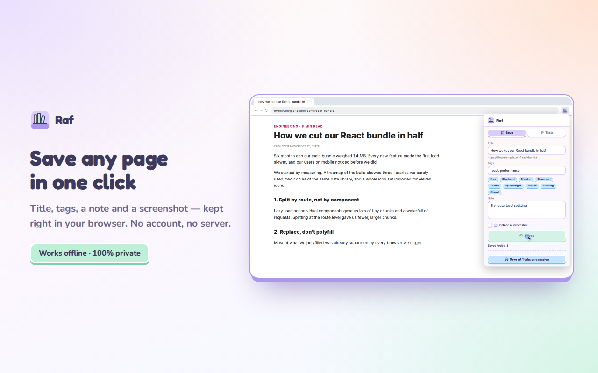
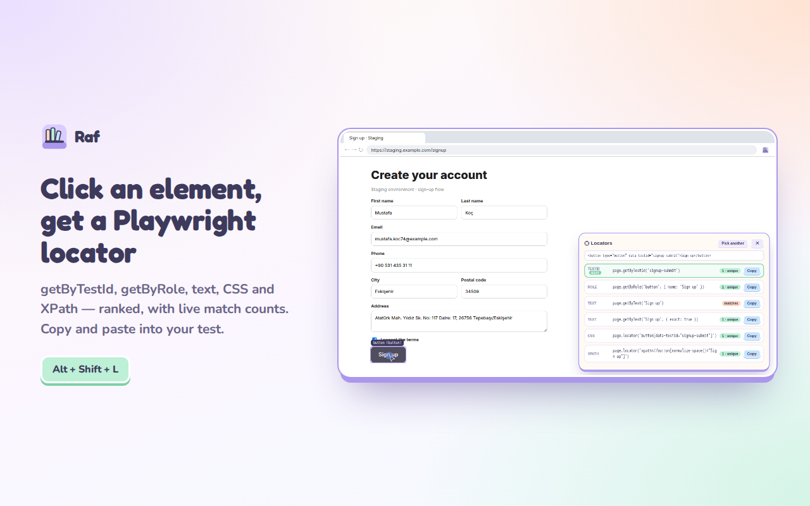

<p align="center">
  
</p>

<h1 align="center">Raf</h1>

<p align="center">
  <b>A private "read later" shelf in your browser, plus test tools for developers. Add your own server for video downloads and a Telegram bot.</b>
</p>

<p align="center">
  <b>English</b> · <a href="README.tr.md">Türkçe</a>
</p>

<p align="center">
  <br>
  <sub>▶️ <a href="https://youtu.be/_U53kZwrMeg">Watch the demo video on YouTube</a></sub>
</p>

Raf (*"shelf"* in Turkish) saves the page you're looking at in one click: title, tags, a note, the page's readable text and a screenshot. You can find it again later, even if the original site goes away. It also bundles the small tools developers and testers reach for every day.

## Two ways to use Raf

| | **Just the extension** | **With your own Raf server** |
|---|---|---|
| Install | [Download the zip](#install-the-extension) *(Chrome Web Store coming soon)* | Docker, see [Run it](#run-it) |
| Where your shelf lives | In your browser (export / import as JSON) | On your server, the same on every device |
| Save, tags, notes, search, sessions | ✅ | ✅ |
| Dev & test tools, dark mode | ✅ | ✅ |
| Video downloads | Instagram, TikTok and sites that play a plain video file | 1000+ sites incl. YouTube, X, Reddit, with quality choice and audio-only |
| Telegram bot, web app / PWA for the phone | — | ✅ |
| Account or sign-up | none | none, it's your server |

### Install the extension

1. Download **[raf-extension.zip](https://github.com/selimyalinkilic/raf/releases/latest/download/raf-extension.zip)** from the latest release and unzip it.
2. Open `chrome://extensions` and turn on **Developer mode** (top right).
3. Click **Load unpacked** and pick the unzipped folder. Pin Raf from the puzzle icon so it's always one click away.

It starts in local mode, so there's nothing to set up. To update, unzip the new release over the same folder and press ↻ on the Raf card in `chrome://extensions`. Works in Chrome, Edge, Brave and other Chromium browsers.

**What are "Server URL" and "API token" in Settings?** You only need them if you run your own Raf server. The URL is where your server is reachable (e.g. `https://raf.example.com`). The token is the `RAF_API_TOKEN` you chose when setting up the server. It works like a password and is only ever sent to your server. Leave both empty and Raf keeps everything in your browser. If you install the extension from your server's `/extension.zip`, both are filled in for you.

## Screenshots

<table>
  <tr>
    <td align="center" width="50%"><br><sub>Save any page in one click</sub></td>
    <td align="center" width="50%"><br><sub>Playwright locator picker</sub></td>
  </tr>
  <tr>
    <td align="center"><br><sub>With a server: web app with full-text search</sub></td>
    <td align="center"><br><sub>Installable PWA on the phone</sub></td>
  </tr>
</table>

## Features

### Chrome extension
- **Save** the current page, a link or a text selection (popup, right-click menu or <kbd>Alt</kbd>+<kbd>Shift</kbd>+<kbd>S</kbd>). Includes tag suggestions, a note and an optional screenshot of the visible area.
- **Sessions:** save all open tabs at once and reopen them later in a new window.
- **Video download without a server:** a Raf button on Instagram videos (posts, reels, feed), TikTok and any site that plays a plain video file. Saved straight to *Downloads/Raf*.
- **Video & audio download with your Raf server** from YouTube, X/Twitter, Instagram, TikTok, Reddit, Vimeo and [1000+ sites](https://github.com/yt-dlp/yt-dlp/blob/master/supportedsites.md):
  - a **Raf button on top of videos** with quality selection (up to 4K)
  - files land in *Downloads/Raf* automatically
  - sites that need a login (Instagram…) work with your browser session; cookies are sent for that one job only and never stored
- **Send to phone:** QR code of the current page, or send it to your Telegram.
- **For developers & testers:**
  - **Locator picker:** click an element and get a Playwright locator (`getByRole`, `getByTestId`…), <kbd>Alt</kbd>+<kbd>Shift</kbd>+<kbd>L</kbd>
  - **Test data (TR):** names, emails, phone numbers, addresses, valid national ID / tax numbers / IBANs
  - **Fill form:** fill a whole form with one fake person, <kbd>Alt</kbd>+<kbd>Shift</kbd>+<kbd>F</kbd>. Fields you've already typed in are never overwritten.
  - UUID v4 (right-click → *Insert UUID* or <kbd>Alt</kbd>+<kbd>Shift</kbd>+<kbd>U</kbd>), Lorem ipsum, Base64 (UTF-8 safe), JWT decoder, screenshot to PNG / clipboard
- **Settings:** turn every feature, menu entry and tool on or off. UI in English or Turkish.
- Tells you when a newer version is available on your server.

### Server & web app
- FastAPI + SQLite with full-text search that ignores Turkish diacritics (*bakim* finds *bakım*)
- Web UI and installable **PWA** (add to the iPhone home screen), in English and Turkish
- Download queue powered by yt-dlp + ffmpeg; videos are converted to H.264 when needed so they play and save on iPhone
- Downloads page with search, filters (status, type, platform, source, date) and sorting

### YouTube downloads

Without a server Raf only saves videos the page already plays as one complete file (Instagram, TikTok, plain MP4). YouTube streams video and audio in pieces, so YouTube downloads run on your own Raf server (yt-dlp). The version from [GitHub Releases](#install-the-extension), from this repository, or from your server's `/extension.zip` downloads from YouTube too, once it's connected to your server.

The **Chrome Web Store version doesn't**, because Web Store policy doesn't allow extensions that download from YouTube. To get YouTube downloads, [run your own Raf server](#run-it) and install the extension from it. It replaces the store version.

Whatever the version, Raf never downloads from paid / DRM-protected services (Netflix, Disney+, Prime Video, Spotify…) or live streams. Download only what you're allowed to, for personal use.

### Telegram bot
- Send a link and it's saved. Add `#tags` and a note in the same message.
- `/indir <link>` downloads video, `/ses <link>` downloads audio only (files under 50 MB arrive in the chat)
- `/bugun`, `/son`, `/ara <word>` and a daily digest at 21:00

## Run it

```yaml
# docker-compose.yml
services:
  raf:
    build: ./server
    env_file: [raf.env]            # RAF_API_TOKEN=…, optional RAF_TELEGRAM_TOKEN / RAF_TELEGRAM_CHAT_ID
    environment:
      RAF_PUBLIC_URL: https://your-server:8454
      RAF_DIGEST_HOUR: "21"
    volumes:
      - ./data:/data               # database + screenshots
      - ./extension:/ext:ro        # served as /extension.zip, pre-configured with URL + token
      - ./videos:/videos           # downloaded videos
    ports: ["127.0.0.1:8098:8000"]
```

Put it behind HTTPS (e.g. Tailscale Serve, Caddy). Raf is designed for a private network: the web UI has no login of its own, and the API is protected by `RAF_API_TOKEN`.

**Install the extension:**
1. Open `https://your-server/extension.zip` and unzip it.
2. Go to `chrome://extensions` and turn on *Developer mode*.
3. Click *Load unpacked* and pick the unzipped folder.

The server URL and token are already filled in.

**Update:** unzip the new zip over the same folder and press ↻ on the Raf card.

## Project layout

```
server/      FastAPI app (app/main.py, db.py, downloads.py, telegram.py, web.py) + Dockerfile
extension/   Chrome MV3 extension (_locales/en, _locales/tr)
docs/        screenshots, demo, privacy policy, Chrome Web Store listing (docs/store)
scripts/     build-store.sh: builds the Chrome Web Store package into dist/
```

## License

[MIT](LICENSE) © Selim Yalınkılıç · [Privacy policy](docs/PRIVACY.md)

<p align="center"><sub>Icons: <a href="https://lucide.dev">Lucide</a> (ISC) · QR codes: <a href="https://github.com/kazuhikoarase/qrcode-generator">qrcode-generator</a> (MIT) · Video engine: <a href="https://github.com/yt-dlp/yt-dlp">yt-dlp</a></sub></p>
