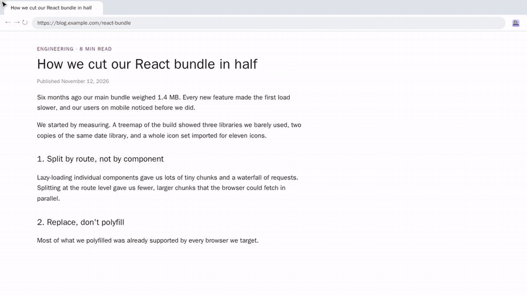
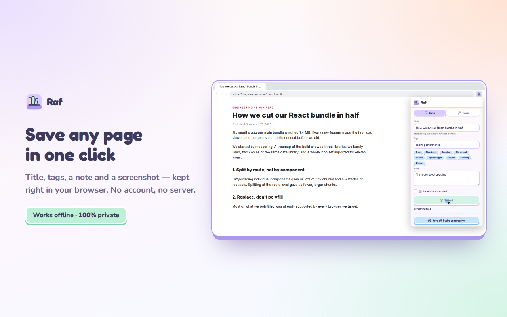
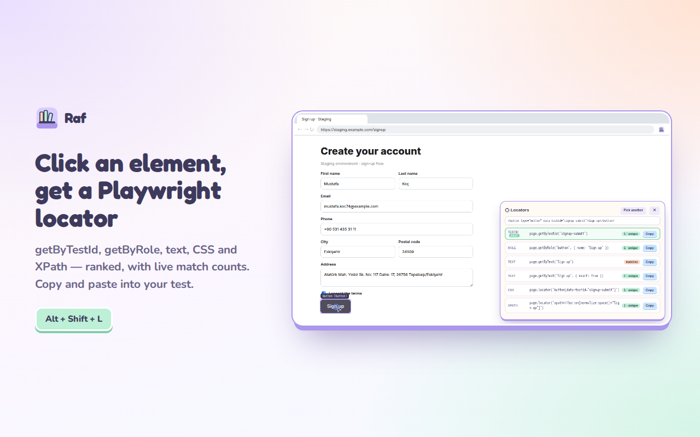
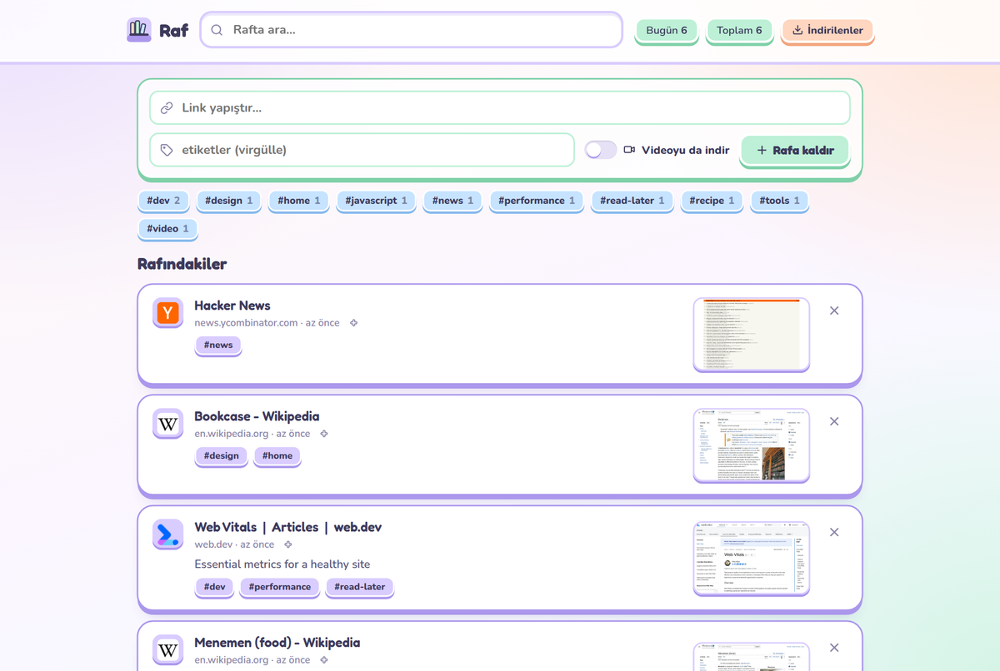
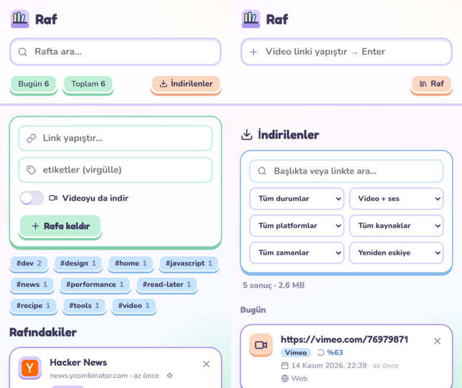

<p align="center">
  
</p>

<h1 align="center">Raf</h1>

<p align="center">
  <b>Tarayıcında özel bir "sonra oku" rafı ve geliştiriciler için test araçları. Kendi sunucunu eklersen video indirme ve Telegram botu da gelir.</b>
</p>

<p align="center">
  <a href="README.md">English</a> · <b>Türkçe</b>
</p>

<p align="center">
  
</p>

Raf, baktığın sayfayı tek tıkla kaydeder: başlık, etiketler, not, sayfanın okunabilir metni ve ekran görüntüsü. Böylece site kapansa bile içeriği bulursun. Geliştiricilerin ve test uzmanlarının her gün kullandığı küçük araçları da bir arada sunar.

## Raf'ı kullanmanın iki yolu

| | **Sadece eklenti** | **Kendi Raf sunucunla** |
|---|---|---|
| Kurulum | Chrome Web Mağazası *(yakında)* ya da *Paketlenmemiş öğe yükle* | Docker, bkz. [Kurulum](#kurulum) |
| Rafın nerede | Tarayıcında (JSON olarak dışa/içe aktarılır) | Sunucunda, her cihazda aynı |
| Kaydet, etiket, not, arama, oturumlar | ✅ | ✅ |
| Geliştirici/test araçları, koyu tema | ✅ | ✅ |
| Video ve ses indirme | — | ✅ |
| Telegram botu, telefon için web uygulaması | — | ✅ |
| Hesap / üyelik | yok | yok, sunucu senin |

**Ayarlar'daki "Sunucu adresi" ve "API anahtarı" ne?** Sadece kendi Raf sunucunu çalıştırıyorsan gerekir. Adres, sunucuna ulaşılan yerdir (ör. `https://raf.example.com`). Anahtar, sunucuyu kurarken belirlediğin `RAF_API_TOKEN` değeridir. Şifre gibidir ve yalnızca senin sunucuna gönderilir. İkisini de boş bırakırsan Raf her şeyi tarayıcında tutar. Eklentiyi sunucundaki `/extension.zip` adresinden kurarsan ikisi de dolu gelir.

## Ekran görüntüleri

<table>
  <tr>
    <td align="center" width="50%"><br><sub>Her sayfayı tek tıkla kaydet</sub></td>
    <td align="center" width="50%"><br><sub>Playwright locator seçici</sub></td>
  </tr>
  <tr>
    <td align="center"><br><sub>Sunucuyla: tam metin aramalı web uygulaması</sub></td>
    <td align="center"><br><sub>Telefona kurulabilen PWA</sub></td>
  </tr>
</table>

## Özellikler

### Chrome eklentisi
- **Kaydet:** sayfayı, bir linki ya da seçili metni kaydet (popup, sağ tık menüsü veya <kbd>Alt</kbd>+<kbd>Shift</kbd>+<kbd>S</kbd>). Etiket önerileri, not ve isteğe bağlı ekran görüntüsü.
- **Oturumlar:** açık sekmelerin hepsini tek seferde kaydet, sonra yeni bir pencerede geri aç.
- **Video ve ses indirme:** YouTube, X/Twitter, Instagram, TikTok, Reddit, Vimeo ve [1000'den fazla site](https://github.com/yt-dlp/yt-dlp/blob/master/supportedsites.md).
  - videoların üstünde **Raf butonu** ve kalite seçimi (4K'ya kadar)
  - dosyalar otomatik olarak *İndirilenler/Raf* klasörüne iner
  - giriş isteyen siteler (Instagram…) tarayıcı oturumunla çalışır; çerezler sadece o indirme için gönderilir, saklanmaz
- **Telefona gönder:** sayfanın QR kodu ya da Telegram'a gönderme.
- **Geliştiriciler ve test uzmanları için:**
  - **Locator seçici:** bir öğeye tıkla, Playwright locator'ını al (`getByRole`, `getByTestId`…), <kbd>Alt</kbd>+<kbd>Shift</kbd>+<kbd>L</kbd>
  - **Test verisi (TR):** ad, e-posta, telefon, adres; doğrulamadan geçen TCKN / VKN / IBAN
  - **Formu doldur:** tüm formu tek bir sahte kişiyle doldur, <kbd>Alt</kbd>+<kbd>Shift</kbd>+<kbd>F</kbd>. Senin yazdığın alanlara dokunmaz.
  - UUID v4 (sağ tık → *UUID ekle* veya <kbd>Alt</kbd>+<kbd>Shift</kbd>+<kbd>U</kbd>), Lorem ipsum, Base64 (UTF-8 uyumlu), JWT çözücü, ekran görüntüsünü PNG/panoya alma
- **Ayarlar:** her özelliği, menü öğesini ve aracı tek tek açıp kapat. Arayüz Türkçe veya İngilizce.
- Sunucuda yeni sürüm varsa haber verir.

### Sunucu ve web uygulaması
- FastAPI + SQLite; Türkçe karakter duyarsız tam metin arama (*bakim* yazınca *bakım* bulunur)
- Web arayüzü ve telefona kurulabilen **PWA** (iPhone ana ekranına eklenebilir), Türkçe ve İngilizce
- yt-dlp + ffmpeg ile indirme kuyruğu; videolar gerekirse H.264'e çevrilir, iPhone'da oynar ve Fotoğraflar'a kaydedilir
- İndirilenler sayfasında arama, filtreler (durum, tür, platform, kaynak, tarih) ve sıralama

### YouTube'dan indirme

Video indirme kendi Raf sunucunda (yt-dlp) çalışır. Bu repodan kurduğun ya da sunucundaki `/extension.zip`'ten indirdiğin sürüm YouTube'dan da indirir.

**Chrome Web Mağazası sürümü indirmez**, çünkü mağaza kuralları YouTube'dan indiren eklentilere izin vermiyor. YouTube indirmeyi istiyorsan [kendi Raf sunucunu kur](#kurulum) ve eklentiyi oradan yükle. Mağaza sürümünün yerine geçer.

Hangi sürüm olursa olsun Raf ücretli/DRM'li servislerden (Netflix, Disney+, Prime Video, Spotify…) ve canlı yayınlardan asla indirmez. Yalnızca indirmene izin verilen içerikleri, kişisel kullanım için indir.

### Telegram botu
- Link gönder, kaydedilsin. Aynı mesaja `#etiket` ve not ekleyebilirsin.
- `/indir <link>` video, `/ses <link>` sadece ses indirir (50 MB altı dosyalar sohbete gelir)
- `/bugun`, `/son`, `/ara <kelime>` ve her akşam 21:00'de günlük özet

## Kurulum

```yaml
# docker-compose.yml
services:
  raf:
    build: ./server
    env_file: [raf.env]            # RAF_API_TOKEN=…, isteğe bağlı RAF_TELEGRAM_TOKEN / RAF_TELEGRAM_CHAT_ID
    environment:
      RAF_PUBLIC_URL: https://sunucun:8454
      RAF_DIGEST_HOUR: "21"
    volumes:
      - ./data:/data               # veritabanı + ekran görüntüleri
      - ./extension:/ext:ro        # /extension.zip olarak sunulur, adres ve anahtar hazır gelir
      - ./videos:/videos           # indirilen videolar
    ports: ["127.0.0.1:8098:8000"]
```

HTTPS arkasına koy (ör. Tailscale Serve, Caddy). Raf özel bir ağ için tasarlandı: web arayüzünün kendi girişi yok, API `RAF_API_TOKEN` ile korunuyor.

**Eklentiyi kur:**
1. `https://sunucun/extension.zip` dosyasını indirip bir klasöre çıkar.
2. `chrome://extensions` sayfasını aç, *Geliştirici modu*'nu aç.
3. *Paketlenmemiş öğe yükle* ile çıkardığın klasörü seç.

Sunucu adresi ve anahtar hazır gelir.

**Güncelleme:** Yeni zip'i aynı klasörün üzerine çıkar, Raf kartında ↻'ye bas.

## Proje yapısı

```
server/      FastAPI uygulaması (app/main.py, db.py, downloads.py, telegram.py, web.py) + Dockerfile
extension/   Chrome MV3 eklentisi (_locales/en, _locales/tr)
docs/        ekran görüntüleri, demo, gizlilik politikası, Chrome Web Mağazası metinleri (docs/store)
scripts/     build-store.sh: Chrome Web Mağazası paketini dist/ altına üretir
```

## Lisans

[MIT](LICENSE) © Selim Yalınkılıç · [Gizlilik politikası](docs/PRIVACY.md)

<p align="center"><sub>İkonlar: <a href="https://lucide.dev">Lucide</a> (ISC) · QR kod: <a href="https://github.com/kazuhikoarase/qrcode-generator">qrcode-generator</a> (MIT) · Video motoru: <a href="https://github.com/yt-dlp/yt-dlp">yt-dlp</a></sub></p>
